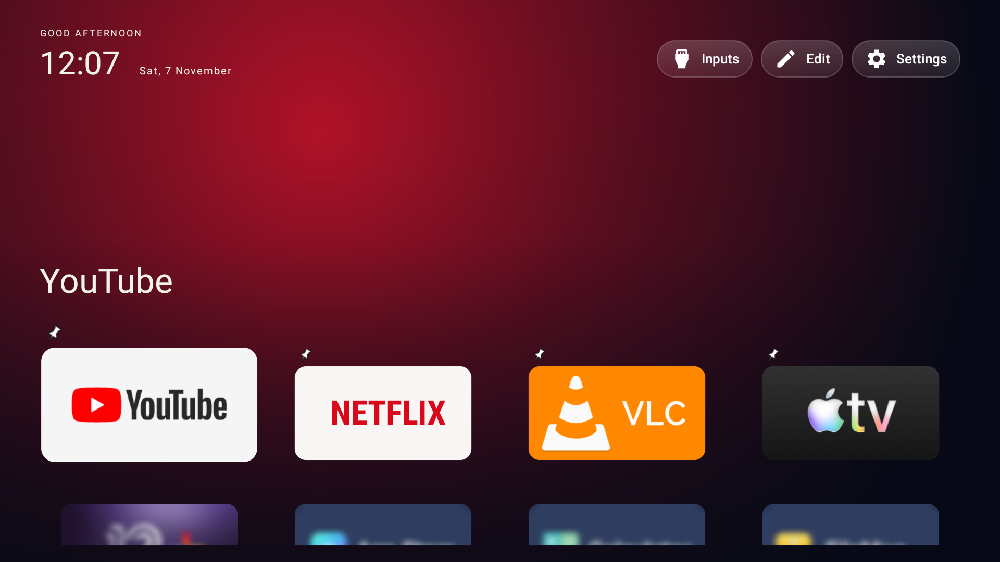
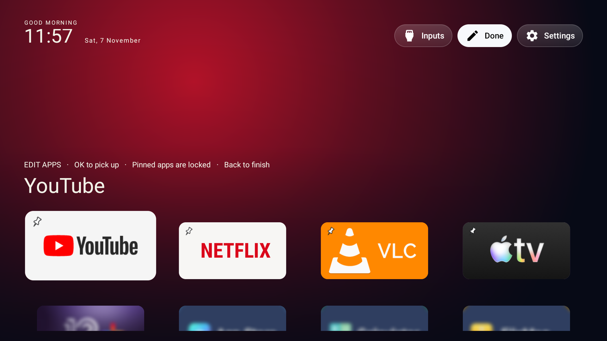

# Vibe HY320

A lightweight, native Android launcher for our Allwinner H713 / Android 11 HY320, plus reproducible ADB diagnostics. Built for a 1 GB device: bounded icons, native views, no WebView, no downloaded backgrounds, and no continuous background monitoring.

## Comparison with the legacy launcher

On the tested HY320, a short matched test alternated the actual default Home between Vibe 0.8.0 and HTCLauncherEN. The warm idle-Home medians were:

| Measurement | Legacy launcher | Vibe | Observed difference |
|---|---:|---:|---|
| Launcher process RAM (PSS) | 89.6 MiB | 40.7 MiB | 54.6% smaller Vibe footprint |
| Whole-device CPU busy | 47.1% | 8.8% | 81.2% less sampled idle CPU activity |
| Available system RAM | 369.3 MiB | 360.7 MiB | No overall RAM saving demonstrated |

The old launcher's foreground keep-alive service remained resident after switching to Vibe, so the smaller Vibe process did not translate into more available system memory in this test. Results are short sequential samples on one device; they do not establish playback, navigation-speed, power or long-term improvements. See the [full comparison and methodology](launcher/DEFAULT_LAUNCHER_COMPARISON_REPORT.md).

## Screenshots





The Edit screenshot predates the pin placement shown in the Home screenshot.

## Install the launcher

**No build tools needed:** follow the [step-by-step USB installation guide](INSTALL.md). It covers downloading an APK, installing it with the remote, and returning to the original launcher.

The following developer instructions build a locally signed APK and install it with ADB. The tested projector is the Allwinner H713 HY320 running Android 11 and firmware `UI_Veng.projector.20241225.164550`.

1. **Install the build tools.** You need Python 3, JDK 17, and an Android SDK with Platform 34, Build Tools 34.0.0, and Platform Tools. Put `adb`, `javac`, and `keytool` on your PATH. The build defaults to `~/Library/Android/sdk` on macOS. Set `ANDROID_SDK_ROOT` if your SDK is elsewhere.

2. **Clone the repository and build the APK.**

   ```sh
   git clone https://github.com/oshriagronov/debloat-HY320.git
   cd debloat-HY320
   python3 launcher/build.py
   ```

   The APK is written to `launcher/build/vibe-home-<version>.apk`, using the app version from the manifest. Keep the generated `launcher/local-debug.keystore` private and reuse it for updates. Android requires updates to use the same signing key as the installed copy.

3. **Connect to the projector.** Enable ADB debugging in the projector’s Developer options. For a projector with network ADB enabled, connect the computer and projector to the same network, replace the example address with your projector’s address, and approve the debugging prompt if it appears.

   ```sh
   projector=192.168.1.50:5555
   adb connect "$projector"
   adb devices -l
   ```

   Check that your projector is listed as `device` before proceeding. For a USB ADB connection, set `projector` to the serial shown by `adb devices -l` and skip `adb connect`.

4. **Install and open Vibe Home.**

   ```sh
   adb -s "$projector" install --no-incremental -r launcher/build/vibe-home-*.apk
   adb -s "$projector" shell am start -W -n com.vibehome.launcher/.MainActivity
   ```

5. **Choose the default launcher if you want Home to open Vibe.** In Vibe, go to **Settings → About → Use Vibe Home**, then confirm the choice in Android. To switch back, use **Settings → About → Use original launcher** and select **HTCLauncherEN** if Android asks. Installing the APK preserves the current default.

See the [launcher README](launcher/README.md) for build overrides and device checks, and the [diagnostic report](DIAGNOSTIC_REPORT.md) for the tested hardware and firmware.

## Credits and inspiration

- **[CleanYourTV](https://github.com/Gathin23/cleanyourtv)** by Gathin23 / contributors, MIT license. Inspiration: a focus-driven app top shelf, a clear favorites dock, device-settings entry points and restrained motion for modest hardware. Inspected commit `fc148d5a9707b30e8f49f489625947421740dc55`.
- **[Tellyscope](https://github.com/man15h/tellyscope)** by man15h / contributors, GPL-3.0-only according to its source headers and notice. Inspiration: tonal surfaces, clear menus and device status, reviewing a proposed change before applying it, and preserving the prior state for undo. Inspected commit `ec9058de10fdc9c06ec4deeac22331ab0a960684`.

Both projects are cloned under `references/` and excluded by the root `.gitignore`. Vibe's menu uses three CleanYourTV vector icons for Wi-Fi, Settings and HDMI. Their MIT notice is included in the APK and in [CLEANYOURTV-LICENSE.txt](launcher/CLEANYOURTV-LICENSE.txt). Installed app icons and TV banners belong to their respective owners and are loaded from apps on the device.

Vendor APK/framework inspection stays local under ignored `research/vendor-settings/`. It is evidence for this specific firmware, not a source of bundled vendor code or assets. No system-signing key or privileged UID is used.

## Privacy

Vibe Home does not send personal data to the developer or an analytics service. It uses and stores some information locally to operate; see the [privacy disclosure](PRIVACY.md) for details.

## License

This project is licensed under the [MIT License](LICENSE). Third-party assets retain their respective licenses and ownership as described above.
